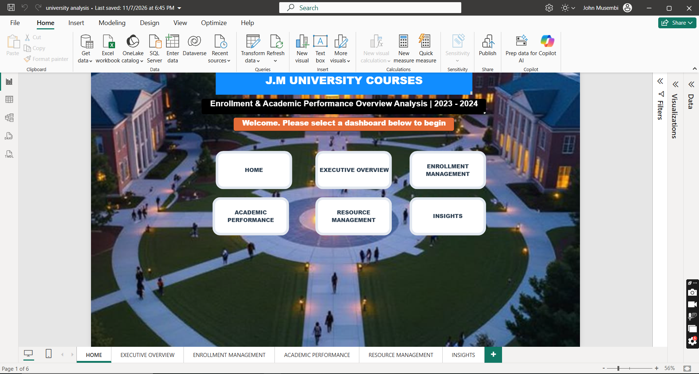
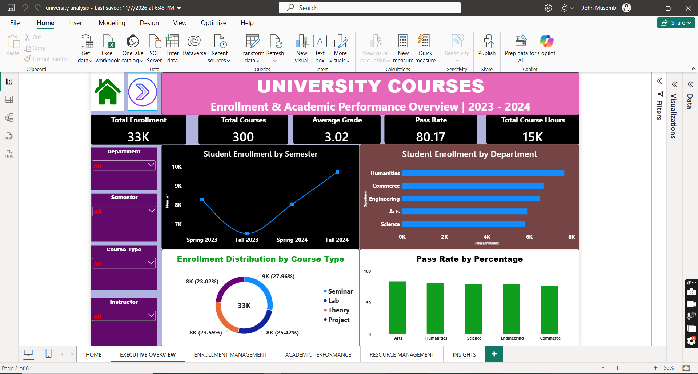
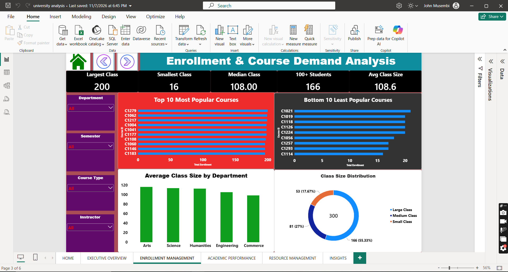
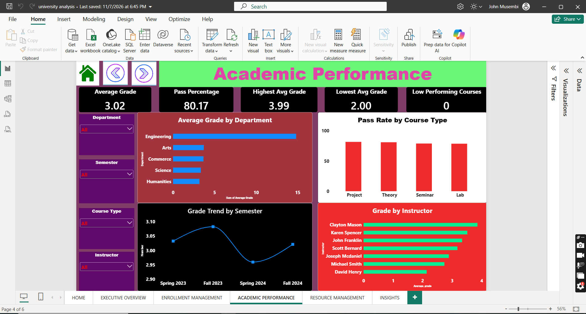
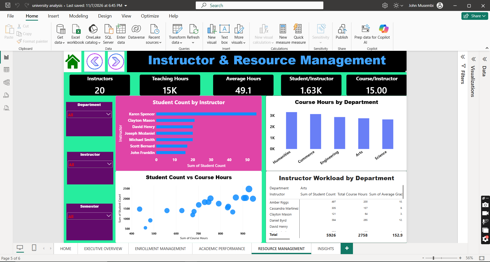
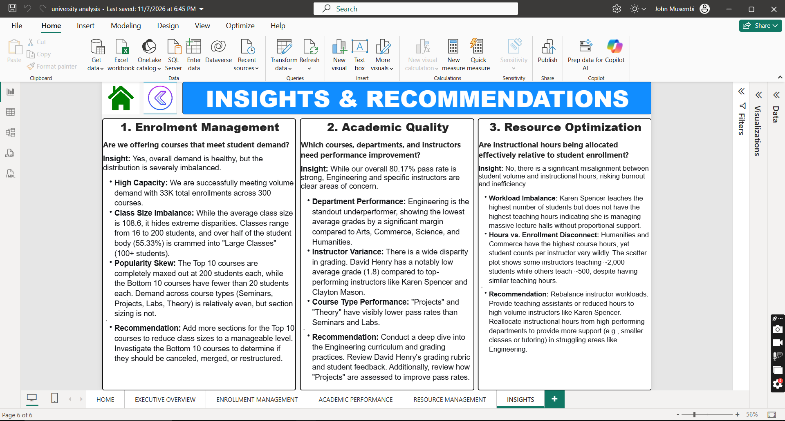

# 🎓 JM University Courses Analysis
#  Enrollment & Academic Performance Analytics

## 📌 Project Overview
This Power BI project provides a comprehensive 360-degree view of university operations for the 2023–2024 academic year. The goal of this analysis is to help university stakeholders (Deans, Department Heads, and Administrators) make data-driven decisions regarding student enrollment, academic quality, and resource allocation.

The report features a custom, visually engaging Home Page with interactive navigation buttons, allowing users to seamlessly transition between detailed analytical dashboards and the final insights page.

### 📈 Key Metrics at a Glance
* **Total Enrollments:** 33,000+
* **Courses Analyzed:** 300
* **Overall Pass Rate:** 80.17%
* **Total Instructors:** 20
* **Total Course Hours:** 15K

---

## 📸 Dashboard Gallery

### 🏠 Home Page
*A visually engaging landing page with custom navigation buttons to easily access all reports.*

### 📈 Executive Overview
*High-level summary of total enrollment (33K), overall pass rate (80.17%), and departmental distributions.*

### 🎓 Enrollment Management
*Analysis of student demand, class size distributions, and identification of the most and least popular courses.*

### 🏆 Academic Performance
*Deep dive into pass rates by course type, average grades by department, and instructor-level grading trends.*

### ⏱️ Resource Management
*Review of instructor workloads, teaching hours allocation, and student-to-instructor ratios.*

### 💡 Insights & Recommendations
*A summary page compiling the key business answers and actionable recommendations for university leadership.*

---

## 📊 Business Questions Answered

The dashboard is structured to answer three critical business questions:

1. **Enrolment Management:** Are we offering courses that meet student demand?
   * *Insight:* Overall demand is healthy (33K enrollments), but there is a severe imbalance. Over 55% of students are crammed into large classes (100+ students), while the Bottom 10 courses struggle to fill 20 seats.
2. **Academic Quality:** Which courses, departments, and instructors need performance improvement?
   * *Insight:* While the overall pass rate is strong (80.17%), the Engineering department is a clear outlier with the lowest average grades. Specific instructors show significant grading variances that require review.
3. **Resource Optimization:** Are instructional hours being allocated effectively relative to student enrollment?
   * *Insight:* No, there is a misalignment. Top-volume instructors are managing massive lecture halls without proportional support, indicating a need to rebalance workloads and reallocate teaching hours.

---

## ⚙️ Methodology

1. **Data Extraction:** Imported raw university dataset (CSV/Excel).
2. **Data Transformation (Power Query):** Cleaned missing values, standardized department names, and created custom columns for "Class Size Categories" (Large, Medium, Small).
3. **Data Modeling:** Created a Star Schema connecting the Fact table (Enrollments) to Dimension tables (Courses, Instructors, Date).
4. **DAX Measures:** Developed custom measures for Pass Rate %, Average Class Size, and Student-to-Instructor Ratios.
5. **UI/UX:** Designed a custom navigation system using Power BI buttons, shapes, and action triggers.

---

## 🧠 Challenges & Solutions
* **Challenge:** The raw data contained massive disparities in class sizes making averages misleading.
* **Solution:** I introduced "Class Size Distribution" visualizations (Large, Medium, Small categories) to provide a more accurate picture of the student experience.
* **Challenge:** Creating a seamless navigation experience within Power BI.
* **Solution:** Utilized Power BI's "Action" feature on transparent shapes, combined with page hiding, to simulate an app-like UI.

---

## 🛠️ Tools & Technologies Used
* **Power BI Desktop:** Data modeling, DAX calculations, and report visualization.
* **Power Query:** Data cleaning and transformation.
* **DAX:** Custom measures for KPIs (e.g., Pass Rate %, Student/Instructor Ratio, Course Hours).
* **UI/UX Design in Power BI:** Utilized custom shapes, action buttons, and background images for an app-like navigation experience.

---

## 🚀 How to Use This Repository
1. Clone the repository or download the `.pbix` file.
2. Open it using **Power BI Desktop** (version 2023 or later recommended).
3. If prompted, update the data source settings to point to your local dataset.
4. Use the **Home Page** buttons to navigate through the different analytical views.

---

## 💡 Key Recommendations (Summary)
* **Add Sections:** Increase sections for the Top 10 most popular courses to reduce class sizes.
* **Engineering Intervention:** Conduct an immediate curriculum and grading review for the Engineering department.
* **Workload Rebalancing:** Provide Teaching Assistants (TAs) to instructors managing the highest student volumes (e.g., Karen Spencer).

---
## 👤 Author
**John Musembi**
*Data Analyst*

## 🤝 Feedback & Contributions
This project is part of my data analytics portfolio. If you have any feedback on the DAX measures, visual design, or data storytelling, feel free to open an issue or reach out to me on [LinkedIn](https://www.linkedin.com/in/john-mwendwa-0660b6314/).

*If you find this project helpful, please consider giving it a ⭐!*
